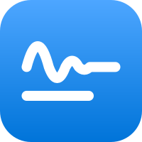
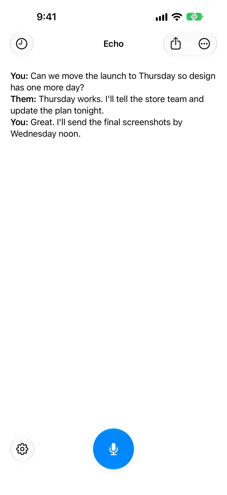
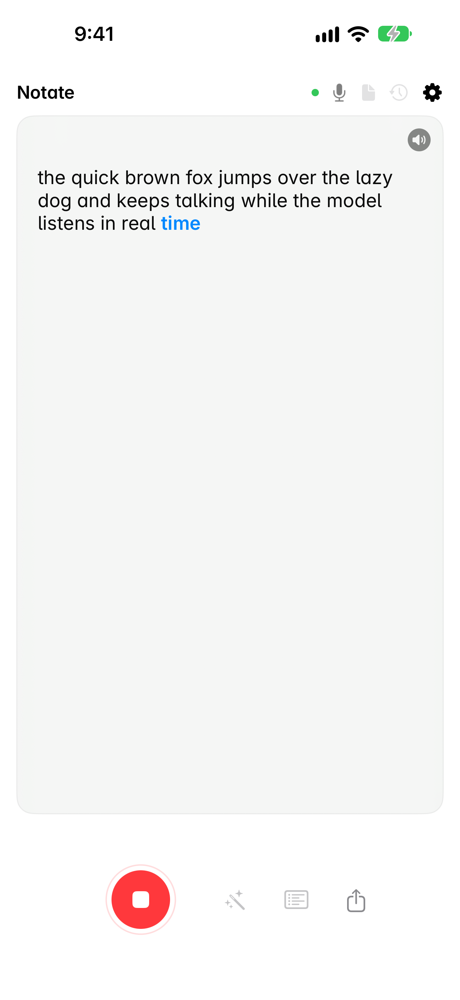
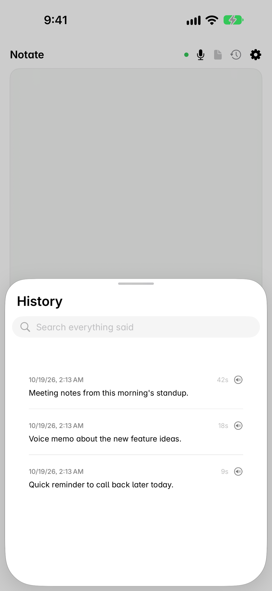
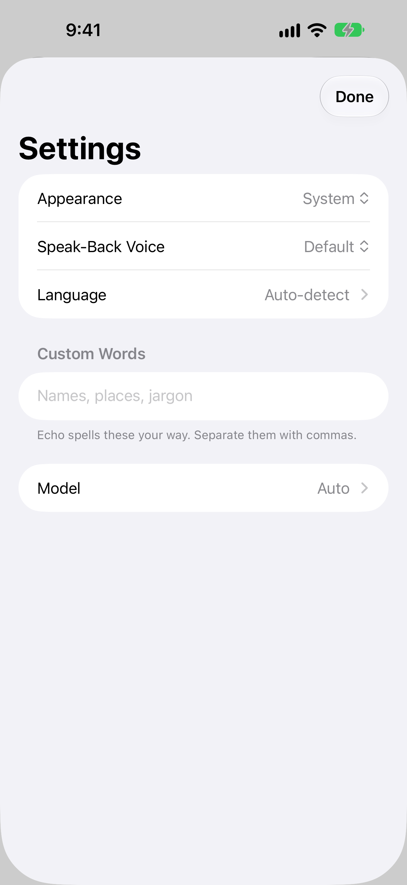

# Echo

   [](https://github.com/nulljosh/echo/actions/workflows/test.yml)

Say it once. It comes back written down, on your iPhone, Mac or Watch. Nothing leaves the device.

[echo.jaybulb.com](https://echo.jaybulb.com) · [App Store](https://apps.apple.com/app/id6782604262) · formerly Notate

<p align="center">
  
  
  
  
</p>

## What it does

- Live transcript as you talk, the word being heard lit up
- Mac meetings: your mic and the call, labelled You and Them, no bot
- Clean up and summarize with Apple Intelligence, on device
- Files, Shortcuts, the Action button and the Watch
- Search everything said. Export TXT, Markdown or SRT
- 99 languages. $1 once, no subscription


## Build and test

```bash
xcodegen generate && open voxprint.xcodeproj
TEST_RUNNER_VOXPRINT_QA=1 xcodebuild test -scheme VoxprintTests -destination 'platform=macOS' CODE_SIGNING_ALLOWED=NO
```

The QA run breaks the model on purpose and checks Echo heals, then transcribes real speech. Nothing ships unless it passes.

## Docs

[Whitepaper](docs/WHITEPAPER.md) · [Architecture](docs/ARCHITECTURE.md) · [Roadmap](docs/roadmap.md) · [Contributing and security](docs/CONTRIBUTING.md)

Apache 2.0. Copyright 2026 Joshua Trommel.
