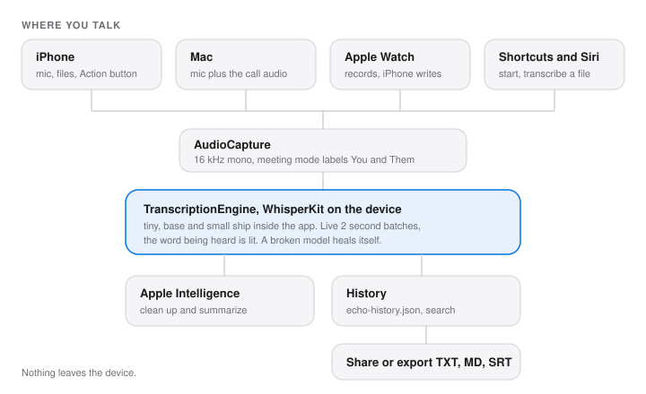

# Architecture

You tap record. `AudioCapture` hands 16 kHz mono audio to `TranscriptionEngine`, which runs WhisperKit on the device every 2 seconds and lights the word being heard. Stop, and it makes one final pass, saves the entry to history and keeps it searchable. Nothing goes to a server.

## Files

| File | What it owns |
|---|---|
| `Sources/iOS/VoxprintApp.swift` | iOS entry, theme, What's New overlay, starts the Watch bridge |
| `Sources/iOS/WatchBridge.swift` | Takes Watch recordings, transcribes them on the iPhone, sends the text back |
| `Sources/iOS/WhatsNewSheet.swift` | One-time What's New sheet per version |
| `Sources/macOS/VoxprintApp.swift` | Mac entry, theme, 800 by 560 minimum window |
| `Sources/macOS/voxprint-mac.entitlements` | Sandbox: microphone, user-selected files, network for the large model |
| `Sources/Models/TranscriptionEntry.swift` | Codable entry: text, date, duration, model, summary, timed lines |
| `Sources/Services/TranscriptionEngine.swift` | The engine's state, settings, history and saving |
| `Sources/Services/TranscriptionEngine+Models.swift` | Loading, upgrading, healing and caching Whisper models |
| `Sources/Services/TranscriptionEngine+Live.swift` | Recording: mic and meeting capture, 2 second batches, You and Them, decoding options |
| `Sources/Services/TranscriptionEngine+Apple.swift` | Apple first: when it runs, the live session, the early-stop path |
| `Sources/Services/TranscriptionEngine+Files.swift` | Files, clean up, summary, copy and delete |
| `Sources/Services/AudioCapture.swift` | AVAudioEngine tap, 16 kHz mono Float32, level for the waveform |
| `Sources/Services/SystemAudioCapture.swift` | Mac meeting mode: what the Mac plays, through ScreenCaptureKit |
| `Sources/Services/DictationBridge.swift` | The keyboard handoff: state and finished text in a shared Keychain group, Darwin signals for stop and text ready |
| `Sources/Services/Keychain.swift` | Small Keychain strings: the account refresh token, and the shared group for the keyboard |
| `Sources/Services/AppleSpeech.swift` | Apple SpeechAnalyzer on iOS 26 and macOS 26: installs the language model, live sessions and files |
| `Sources/Services/Cleanup.swift` | Apple Foundation Models: clean up and summary, on device |
| `Sources/Services/Exporter.swift` | Text, Markdown and SRT export |
| `Sources/Services/Intents.swift` | Shortcuts and the Action button: start recording, transcribe audio |
| `Sources/Services/Account.swift` | The optional account on jaybulb-api: sign up, sign in, reset, rename, delete; refresh token in the Keychain |
| `Sources/Services/SpeechManager.swift` | Reads a transcript aloud with the chosen system voice |
| `Sources/Views/ContentView.swift` | The screen: transcript, record, the bottom bar (Settings, Meeting on Mac, Share, More), History, Mac drop, the `-ECHO_DEMO` promo hook |
| `Sources/Views/TranscriptionView.swift` | Transcript, live word with its pop, errors, unusual language badge |
| `Sources/Views/RecordButton.swift` | Record button and the Liquid Glass helpers |
| `Sources/Views/HistoryView.swift` | History with native search, swipe and context menu |
| `Sources/Views/SettingsView.swift` | One Form: appearance, voice, language, custom words, model |
| `Sources/Views/AccountView.swift` | Settings > Account: sign in or create, forgot password, profile, sign out, delete |
| `Sources/Views/SummaryView.swift` | Summary and action items sheet |
| `Sources/Views/WaveformBarsView.swift` | Five bars driven by the mic level |
| `Sources/Views/EchoFont.swift` | `Font.echo`, the system font |
| `Keyboard/` | The Echo keyboard: a dictate key that opens Echo to record, plus space, delete, return and globe. Never touches the mic |
| `watchos/` | Standalone Watch recorder: record, history, playback, send to iPhone |
| `Tests/ModelRecoveryTests.swift` | The QA gate: corrupt model heals, fallback works, custom words, real speech |
| `Tests/TranscriptionEntryTests.swift` | Entry formatting |
| `Tests/BenchmarkTests.swift` | Opt-in benchmark of every engine (load, speed, word error rate) and the WER check |
| `Tests/AccountTests.swift` | Account errors read as plain sentences |
| `Tests/DictationBridgeTests.swift` | The keyboard handoff: text arrives once, state round-trips, a Darwin signal lands |
| `Tests/AppleSpeechTests.swift` | Apple first: when it runs, real speech through the live session and the engine, a stop while starting, and files |
| `UITests/`, `UITests-mac/` | App Store screenshots from mock data (`UITEST_*` launch flags) |
| `scripts/update_screenshots.sh` | Runs the iPhone screenshot test and copies the set into `screenshots/appstore` |
| `scripts/fetch-tiny-model.sh` | Fetches the bundled models before a Release build |
| `docs/index.html`, `landing.css`, `landing.js`, `tokens.css` | The landing page at echo.jaybulb.com |
| `docs/app.html`, `styles.css`, `script.js`, `devices.css` | The web app |
| `docs/brand.html`, `brand/` | Brand kit and design system |
| `docs/privacy.html` | Privacy policy |
| `docs/account.html` | Where confirm and reset emails land; sets the new password |

## Docs

| File | What it is |
|---|---|
| `README.md` | The front page |
| `CLAUDE.md` | How to work on Echo (AGENTS.md links to it) |
| `docs/WHITEPAPER.md` | How it works, in one page |
| `docs/roadmap.md` | What is still open |
| `docs/BENCHMARKS.md` | Measured speed and accuracy of every engine |
| `docs/MONEY.md` | Price and how Echo makes money |
| `docs/APPSTORE.md` | Store listing, review notes, privacy answers |
| `docs/CONTRIBUTING.md` | Setup, tests, reporting a security issue |
| `docs/LOOP-HANDOFF.md` | Where the build loop stands |
| `brand/BRAND.md` | Brand kit |
| `launch/` | Launch kit: Product Hunt, HN, Reddit, X, directories, and `echo-promo.mp4` |

## Storage

- `Documents/echo-history.json`: every transcript, no cap.
- `Application Support/echo-models/`: a downloaded large model, kept where iOS cannot purge it.
- UserDefaults: settings, including the chosen model and language (`echo.selectedModel`, `echo.selectedLanguage`). The keys keep their old `echo.*` and `notate.*` names on purpose. Under XCTest the engine writes to the `echo-tests` suite instead, so tests never touch the real app's settings.

## Gotchas

- App icon PNGs must have no alpha, or upload fails with 90717.
- Versions live only in `project.yml`. Never run `xcodegen generate` between a version bump and the archive.
- A Release build fails without the bundled models. Run `scripts/fetch-tiny-model.sh` first.
